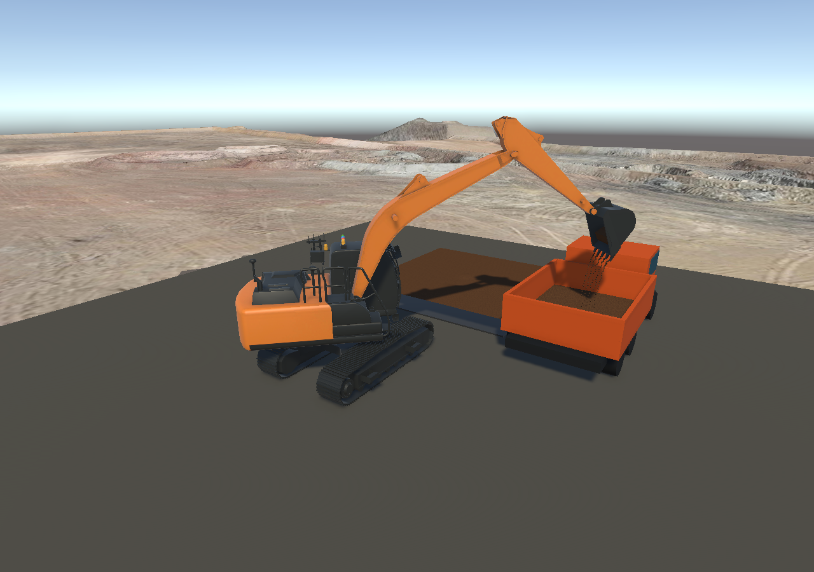
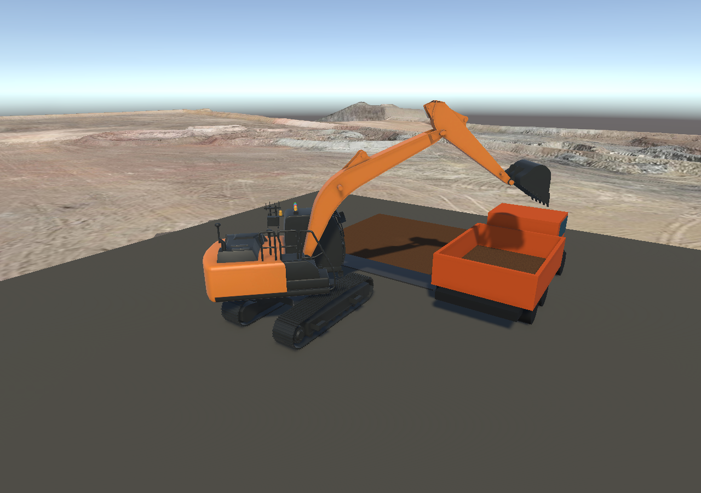

# 斗口进土与分布卸料

目标场景：`Assets/Scenes/sence_test.unity`。本轮只修改共享脚本与测试，不重建或覆盖主场景。

## 行为变化

- 刃口必须有足够的水平切削分量，并朝斗口有效迎土。纯竖直压入、斗背/擦边、斗口明显朝下，不再自动装土。
- 有标定斗腔的设备按当前姿态可保有的空间限制本次切削量；接不住的部分留在 Terrain，不先挖掉再丢失。当前仍不模拟推土、土块脱离后自然坍塌。
- 显著单帧运动与累计切削段都进行进土检查；最多 2 mm 的小幅关节往复允许累计净行程，避免慢速切削被抖动不断取消。短距离前移后再竖直下压不能借用旧行程进土。
- 沿斗口宽度设置 3～5 个出土位置；侧倾时更多土从低侧排出，位置和速度有确定性的逐次变化。余土逐渐收窄、减少出土位置并间歇落下。
- 每个出口分别检查实体遮挡，被挡部分留在斗内。实际释放的体积才进入下落账本，落点决定车厢接收、回填或撒落。
- 修复多个土块先后落入车厢时，前一块抬高土面使后一块漏判并永远留在下落账本的问题。

界面新增独立的“进土”状态行，卸料状态不会再遮盖进土拒绝原因。切削深度和满斗仍由已有柔性约束保护，向上退出保持可用。

## 在主场景试用

退出 Play，等待脚本编译完成，再运行 `sence_test`。当前场景原始待机姿态偏打开，不能再只降动臂就自动装土。

根据实际键盘输入代码与关节运动核对，按键如下（旧车厢文档中的部分方向描述有误，已更正）：

| 动作 | 按键 |
|---|---|
| 收斗 / 翻斗打开 | H / Y |
| 降动臂 / 抬动臂 | R / F |
| 收斗杆 / 伸斗杆 | G / T |
| 向本场景右前方车厢回转 / 返回 | E / Q |
| 土区、土量与接收记录复位 | Backspace |

推荐顺序：先在空中适度 H 收斗，让斗口适合迎土；R 降到土面附近，G 收斗杆切入；F 轻抬脱离受阻土层后继续 H 保土，抬过车厢侧壁再 E 回转，最后 Y 翻斗。观察姿态与界面反馈调整，不要把固定按键时长当作通用自动程序。

测试通过手动控制接口驱动真实物理关节，不是直接设置关节实际位置或直接向斗内填入土量，也不代替人工按键体验验收。

## 参数与边界

`BucketSoilCutter` 新增水平运动比例（默认 0.25）、斗口迎土方向点积（默认 0.45）和斗口朝上点积下限（默认 -0.15）。`CanCollectMovement` 与 `Status` 可供后续控制器读取。

这是基于刃口、斗口和标定斗腔的简化进土规则，不是任意网格布尔切割或颗粒接触求解。卸料使用有体积账本的少量土块轨迹与网格显示，没有为每粒土添加 Rigidbody；视觉土块尺寸存在下限，不能把每个可见土块当作精确颗粒。

Terrain 与 Cesium 路线保持不变。没有加入 VFX Graph 或额外渲染包，没有重新导出或实测 Web 性能。

## 验证记录

- 最终 EditMode：122 项通过，0 失败，见 `intake-flow-edit-final.xml`。
- 最终 PlayMode：11 项通过，0 失败，见 `intake-flow-play-final.xml`，包含主场景装车、回填、旧 Demo、真实关节切削与阻力退出。
- 独立代码审查的问题已修复并加入回归，见两份 `*-review-findings.txt`。保留了主要先失败后通过的测试证据。
- 所有交付脚本与测试和隔离验证项目逐字节一致，SHA-256 清单见 `synced-files.txt`。

最终主场景实测（m³；显示值四舍五入，守恒断言使用原始值、容差 0.00001）：

| 操作 | 累计挖入 | 车厢接收 | 回填 Terrain | 独立地面撒落 | 斗内剩余 |
|---|---:|---:|---:|---:|---:|
| 一斗装车 | 0.080193 | 0.080193 | 0 | 0 | 0 |
| 原土区卸料 | 0.080193 | 0 | 0.076305 | 0.003888 | 0 |

两次完成后下落中与待沉积均为零。这里的零撒落只代表这一组装车姿态，不能推断任意操作都不撒落。

修改前备份：`/home/sk/Unity/intake-flow-backup-20260917-171212`。本轮没有覆盖 `sence_test.unity` 或重新生成施工区资产。
