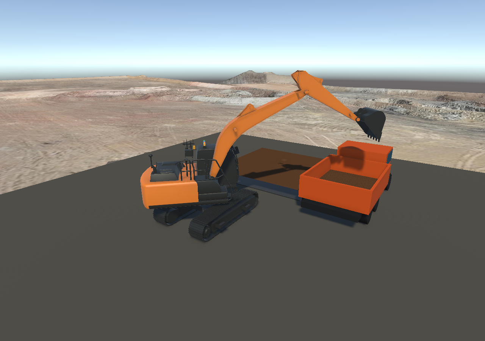

# 主场景车厢装载与切削约束

## 使用

打开 `Assets/Scenes/sence_test.unity`。该场景现在包含原 Cesium 区域、固定作业底盘、局部浅土层、施工垫层与停放自卸车。
如果 Unity 已打开旧版本且场景有未保存改动，先另存这些改动，再重新打开磁盘上的场景；不要用旧场景直接保存覆盖新版本。

- R 下降，F 抬升；H 收斗，Y 翻斗；Q/E 回转，T/G 斗杆（本轮核对键盘代码后更正旧说明）。
- 土接触时输入速度受到限制。持续按 R 不会绕过满斗/切深限制；受阻时先 F 抬升，再调整姿态。
- 装车前先轻抬让刃口退出受阻土层，再收斗、抬升到车厢侧壁上方，再 E 回转到右前方车厢。Y 打开，观察土实际落入车厢后接收量增加。
- 按 Backspace 同步恢复本土区、各斗量、下落土、回填、车厢接收贡献和撒落土堆。
- 本轮是手动流程验证，Space 原来的演示动作不是已标定的自动装车程序，不应当作交付的自主作业功能。

## 车厢与地图

`Assets/ConstructionSite/ParkedDumpTruck.prefab` 是本项目生成的可复用功能性自卸车模型：驾驶室、玻璃、底盘、六轮、底板、左右壁、前壁和尾门。
没有引入外部品牌模型；当前为固定停放车辆，不包含驾驶、悬挂、开尾门或翻车厢动画。

车厢内宽 3 m、内长 4 m，底板高于地面 1 m，接收高度上限 0.8 m，容量 9.6 m³。四壁和底板是实体 Collider，土层接收范围与车厢内壁对应。
来源地图仍为 `osgb_small_005_004`，保持原 CesiumGeoreference 与设备坐标。编辑器使用本地 `file://` 地图路径，不依赖先前的 8000 端口服务。

`ConstructionSiteMapClip` 在流式瓦片创建时复制并删除作业区内相交三角形，同时更换显示网格和碰撞网格。
裁剪采用保守的整三角形删除，不是精确多边形切割；24 m 工作地面覆盖 20 m 裁剪区的接缝。主场景测试检查实际加载瓦片被处理、土区下方不存在遗留地图碰撞。
切换到不同精度地图时应重新检查边缘，大三角形可能令裁剪边缘超出预留范围。运行时裁剪不修改原始 3D Tiles 文件。

## 阻力与穿入约束

`BucketSoilResistance` 提供：

- `PenetrationM`：实际刃口低于当前 Terrain 表面的深度。
- `ResistanceForceN` / `AppliedForce`：当前施加到铲斗的简化切削阻力。
- `IsContacting`、`IsBlocked`、`BlockReason`：供后续自动控制判断接触、受阻及原因。
- `ConstrainPose`：按实际关节轴和刃口运动趋势约束关节目标，不覆写关节物理解算位置。

阻力约为切入面积 × 比阻力，加上速度相关阻尼项，限制最大值。默认比阻力 45 kPa、速度阻尼 6000 N·s/m、最大力 45 kN；这些是仿真调试参数，不是经过土工/液压试验标定的材料参数。
接触时默认关节目标速度上限 6 度/秒。满斗、超过默认 0.18 m 切深、接近土层底部、侧向/反向穿入时阻止进一步深入；向上退出仍允许。
触发后保留驱动中原有支撑重力的偏差，并锁存目标，防止持续输入或逐帧跟随实际角度造成向下爬行。

这是一层刃口探测与关节目标的柔性约束，不是整个铲斗外壳的刚性土体接触求解。惯性和关节弹性允许小幅越过触发阈值；不能将 `maximumPenetration` 理解为零误差硬边界。
实测满斗持续下挖，额外下沉约 0.068 m 后稳定；不可切土测试用 0.08 m 触发阈值，最大深度约 0.158 m，随后可正常抬升退出。

## 土方核对

沿用上一版的来源账本和实际高度图积分，装车与回填测试分别核对：

```
累计挖入 = 斗内 + 下落中 + 待沉积 + 已回填Terrain + 车厢接收 + 独立撒落土堆
Terrain净减少 = 斗内 + 下落中 + 待沉积 + 车厢接收 + 独立撒落土堆
```

回填再挖时累计量与净减少量不同。质量仍使用本轮捕获的密度计算；新增的是切削阻力，尚未加入斗内土质量对整机的可变载荷。
普通地面网格土堆仍不支持二次挖掘；可再次挖掘的是写入 Terrain 的回填部分。

原文件备份：`/home/sk/Unity/truck-site-backup-20260917-xtb53ae3`。原主场景另保存在 `Assets/ConstructionSite/sence_test.before-site.unity`。
本次没有重新导出 Web。Web 构建器仅增加了固定底盘作业场景不等待 Cesium 地面释放的适配，运行包还需单独构建验证。

## 本轮验证结果

- EditMode：111 项通过，0 失败，见 `site-edit-final.xml`。
- PlayMode 回归：11 项通过，0 失败，含真实关节切削、卸料、阻力、主场景装车与回填，见 `site-play-final.xml`。
- 最后调整主场景操作顺序为轻抬、收斗、抬升、回转、卸料后，两项主场景复测均通过，见 `site-main-final.xml`。通过手动控制接口驱动实际物理关节验证，不是人工逐键现场验收，也不是自主控制器。
- 代码审查提出的瓦片卸载后裁剪 Mesh 未释放问题已修复，并加入销毁瓦片后的回归检查；原审查记录见 `site-review-findings.txt`。

单位 m³，显示数值已四舍五入；测试使用未舍入值，守恒容差 0.00001 m³。

| 场景操作 | 累计挖入 | 回填 Terrain | 车厢接收 | 地面撒落 | 斗内剩余 |
|---|---:|---:|---:|---:|---:|
| 挖掘、回转、装车 | 0.083559 | 0.027265 | 0.055434 | 0.000860 | 0 |
| 挖掘、原土区卸料 | 0.083559 | 0.081758 | 0 | 0.001800 | 0 |

两次完成后下落中与待沉积均为零。装车前斗内保有的 0.055434 m³ 全部进入车厢；早期切入/收斗仍有土回落，后续可优化动作与保土姿态，当前不能称为零撒落。



所有交付文件与隔离验证项目逐字节核对一致，清单见 `synced-files.txt`。已保留主场景原有 meta，未覆盖当前编辑器内未保存的场景状态。

后续进土与卸料修正及当前推荐操作见 [斗口进土与分布卸料](../intake-flow-20260917/README.md)，本页计量是上一轮历史结果。
